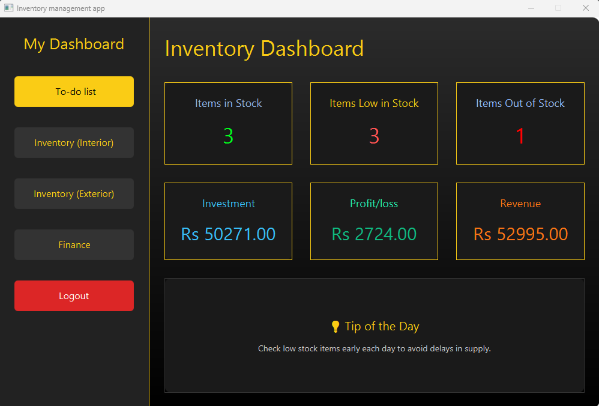
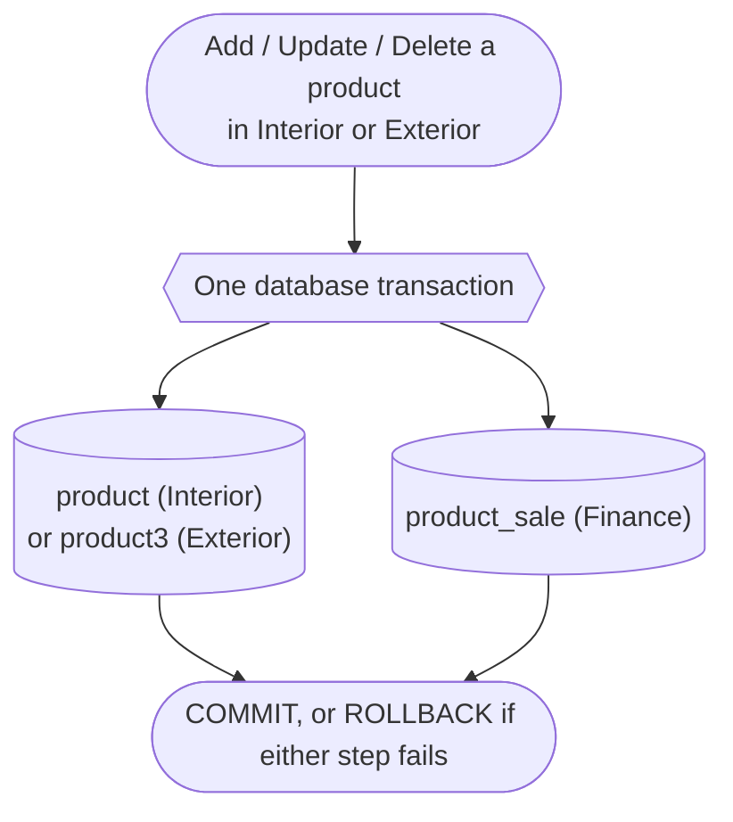
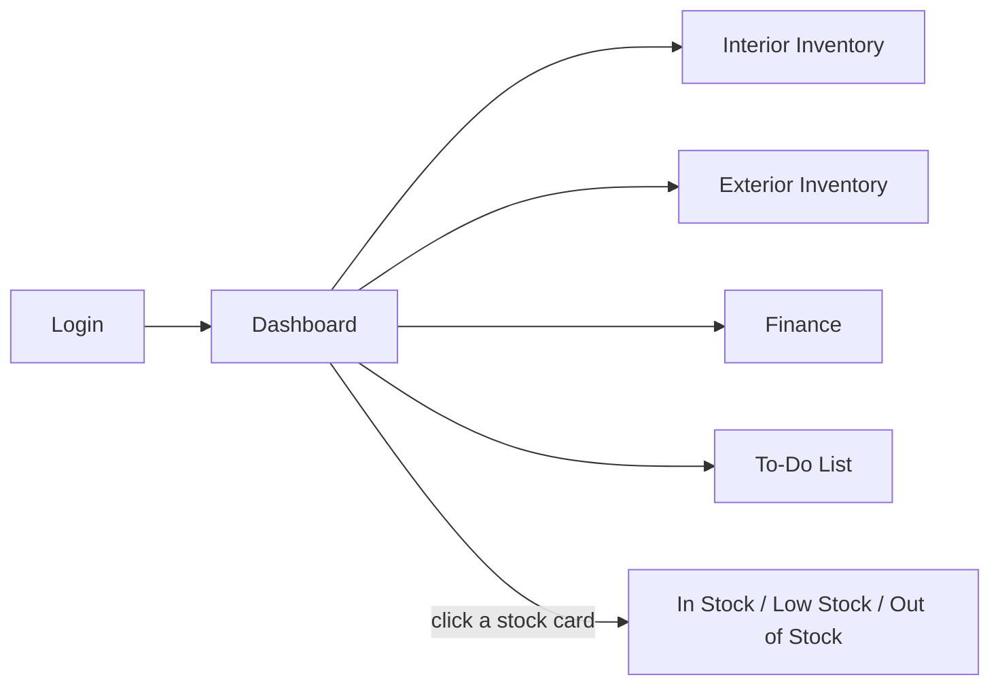
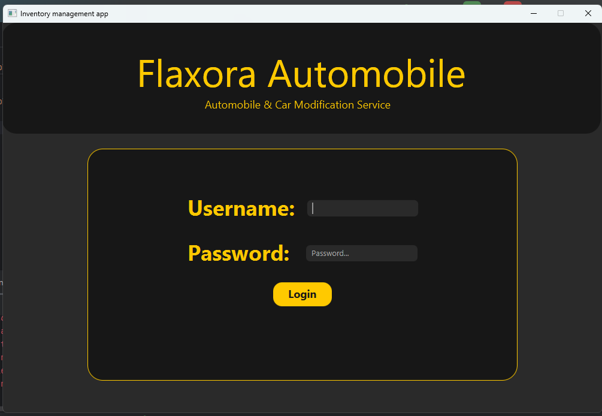
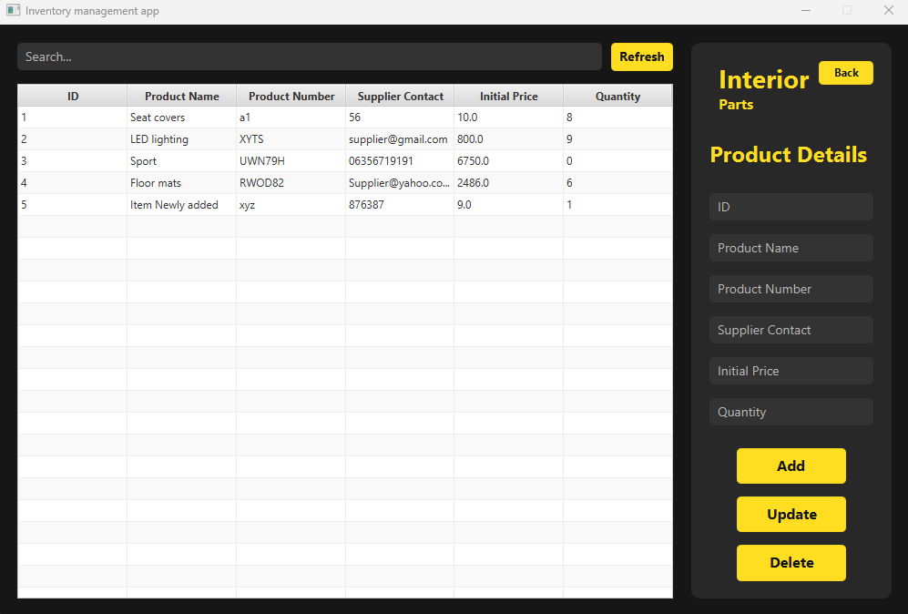
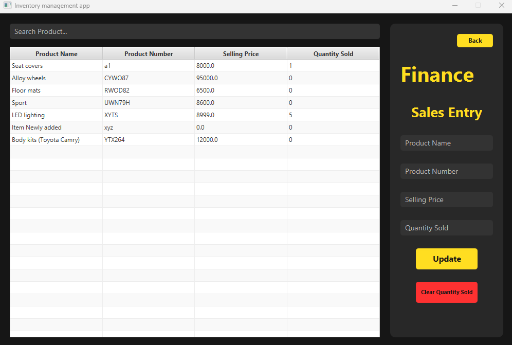
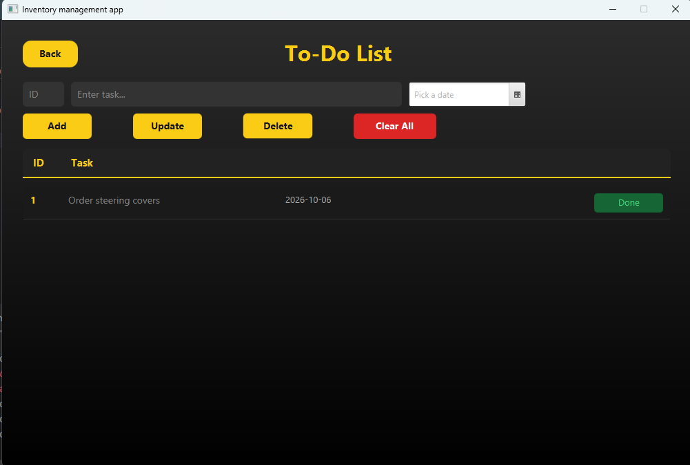
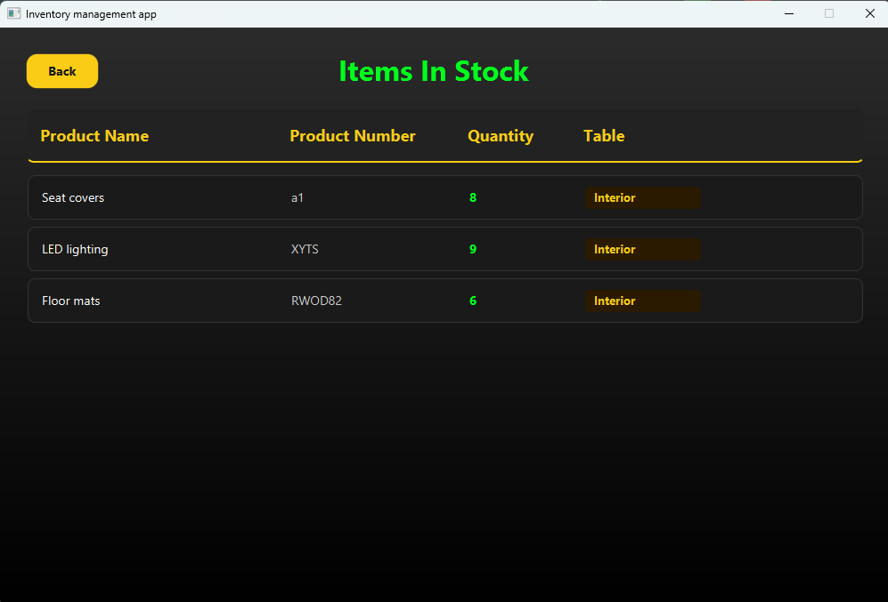
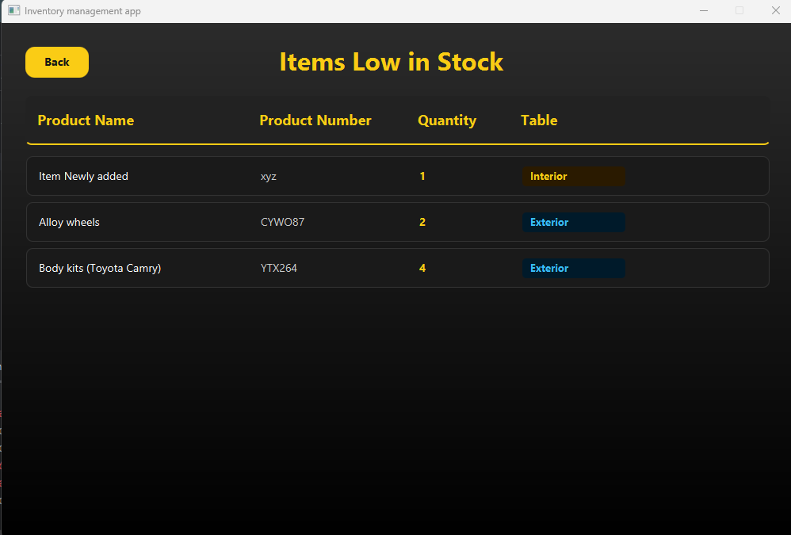
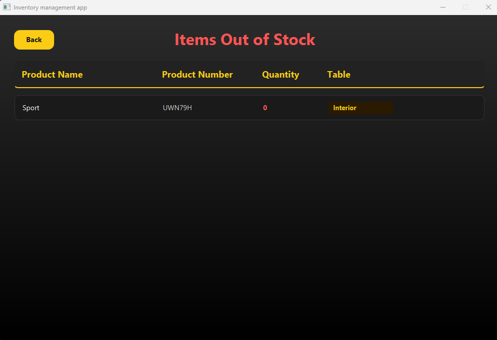

<div align="center">

# 🚗 Flaxora Automobile — Inventory Manager

**A desktop inventory & sales tracker for a car-accessories and modification shop.**
Manage interior and exterior parts, track sales, watch stock levels and see profit at a glance.




</div>

---

## 📑 Table of Contents

- [Features](#-features)
- [How the tables stay in sync](#-how-the-tables-stay-in-sync-the-key-feature)
- [Dashboard & stock rules](#-dashboard--stock-rules)
- [Finance calculations](#-finance-calculations)
- [Screenshots](#-screenshots)
- [Database](#%EF%B8%8F-database)
- [Tech stack](#%EF%B8%8F-tech-stack)
- [Getting started](#-getting-started)
- [Project structure](#-project-structure)
- [Good to know](#%EF%B8%8F-good-to-know)

---

## ✨ Features

| | Feature | What it does |
|---|---|---|
| 🔐 | **Login** | Simple login screen that protects the app. |
| 📊 | **Live dashboard** | Shows stock counts, investment, revenue and profit/loss, all calculated from the database. |
| 🛋️ | **Interior inventory** | Add, update, delete and search interior parts (seat covers, floor mats, LED lighting, ...). |
| 🚘 | **Exterior inventory** | The same tools for exterior parts (alloy wheels, body kits, ...). |
| 🔄 | **Automatic Finance sync** | Every product you add in Interior or Exterior appears in the Finance table automatically. |
| 💰 | **Finance / sales entry** | Set a selling price, record quantity sold, or reset all sales counters in one click. |
| 🚦 | **Stock alerts** | Dedicated *In Stock*, *Low Stock* and *Out of Stock* screens, tagged Interior or Exterior. |
| 🔎 | **Instant search** | Type in the search bar and the table filters live across every column. |
| ✅ | **To-do list** | Add dated tasks, edit or delete them, mark them done, or clear everything. |

---

## 🔄 How the tables stay in sync (the key feature)

You only ever add a product **once**. The app keeps the Finance table up to date for you.



| You do this in Interior / Exterior | What happens automatically in Finance |
|---|---|
| ➕ **Add** a product | A new Finance row is created with the same **name** and **product number**, selling price `0.00` and quantity sold `0`. |
| ✏️ **Update** a product | The Finance row is renamed to the new name / product number (it is matched using the *original* product number). |
| 🗑️ **Delete** a product | The matching Finance row is removed. |

Both steps run in **one database transaction**. If either the inventory write or the Finance write fails, everything is rolled back, so the two tables can never end up out of step.

**Built-in safety checks when adding a product:**
- A popup warns you if the **ID** already exists.
- A popup warns you if the **Product Number** already exists.

After adding a product, open **Finance**, click its row, enter the selling price and press **Update**.

---

## 📊 Dashboard & stock rules

The dashboard reads **both** inventory tables and counts every product by its quantity:

| Card | Rule | Colour |
|---|---|---|
| 🟢 **Items in Stock** | quantity **greater than 5** | green |
| 🟠 **Items Low in Stock** | quantity from **1 to 5** | red |
| 🔴 **Items Out of Stock** | quantity **equal to 0** | dark red |

Click any of these three cards to open a full list. Each row is tagged with a badge showing whether it comes from the **Interior** (gold) or **Exterior** (blue) table.

The dashboard also has quick navigation to **To-do list**, **Inventory (Interior)**, **Inventory (Exterior)**, **Finance**, and **Logout**.



---

## 💰 Finance calculations

```text
Investment  = Σ (current stock quantity + quantity sold) × initial price     (Interior + Exterior)
Revenue     = Σ selling price × quantity sold
Profit/Loss = Revenue − Investment      (shows 0 while revenue is 0)
```

All amounts are shown in **Rs**.

**Worked example with the sample data in `IAsql.sql`:**

| | Amount |
|---|---|
| Investment | Rs 50,271.00 |
| Revenue | Rs 52,995.00 |
| **Profit** | **Rs 2,724.00** |

---

## 📸 Screenshots

<table>
  <tr>
    <td align="center"><b>Login</b><br></td>
    <td align="center"><b>Dashboard</b><br></td>
  </tr>
  <tr>
    <td align="center"><b>Interior inventory</b> (Exterior has the same layout)<br></td>
    <td align="center"><b>Finance / sales entry</b><br></td>
  </tr>
  <tr>
    <td align="center" colspan="2"><b>To-do list</b><br></td>
  </tr>
</table>

<table>
  <tr>
    <td align="center"><b>In stock</b><br></td>
    <td align="center"><b>Low stock</b><br></td>
    <td align="center"><b>Out of stock</b><br></td>
  </tr>
</table>

---

## 🗄️ Database

The database is called `iadatabase` and has four tables:

| Table | Used for | Main columns |
|---|---|---|
| `product` | **Interior** inventory | `ID` (PK), `Product_Name`, `Product_Number`, `Supplier_Contact`, `Initial_Price`, `Quantity` |
| `product3` | **Exterior** inventory | same columns as `product` |
| `product_sale` | **Finance** / sales | `Product_Number` (PK), `Product_Name`, `Selling_Price`, `Quantity_Sold` |
| `to_do_list` | **To-do** tasks | `id` (PK), `task_text`, `task_date`, `completed` |

The full schema and sample data are in [`IAsql.sql`](IAsql.sql).

---

## 🛠️ Tech stack

- **Java 17**
- **JavaFX 17** (UI built with FXML layouts)
- **MySQL 8** with JDBC (MySQL Connector/J)
- **Maven** (with the Maven Wrapper included)

---

## 🚀 Getting started

### Prerequisites
- JDK 17 or newer
- MySQL Server 8 or newer
- **MySQL Connector/J** (the JDBC driver, see step 4)
- Git (and optionally IntelliJ IDEA)

### 1. Clone the project
```bash
git clone https://github.com/YOUR_USERNAME/car-accessories-inventory-manager.git
cd car-accessories-inventory-manager
```

### 2. Create the database
```bash
mysql -u root -p < IAsql.sql
```
This creates `iadatabase`, all four tables and the sample products.

### 3. Add your MySQL login
Open `src/main/java/org/example/ia999/Product_Database.java` and set your own details:

```java
String url = "jdbc:mysql://localhost:3306/iadatabase";
String username = "root";
String password = "Your_Password";   // <- change this
```

### 4. Install the MySQL Connector
The app talks to MySQL through **MySQL Connector/J**, so you must install it before running the app. Choose one option:

**Option A: Maven (recommended).** Add this inside `<dependencies>` in `pom.xml`:
```xml
<dependency>
    <groupId>com.mysql</groupId>
    <artifactId>mysql-connector-j</artifactId>
    <version>8.4.0</version>
</dependency>
```
Then reload Maven (in IntelliJ, click the Maven refresh icon).

**Option B: Add the JAR manually in IntelliJ.**
1. Download **Connector/J** (choose *Platform Independent*) from the [MySQL downloads page](https://dev.mysql.com/downloads/connector/j/) and unzip it.
2. In IntelliJ go to **File → Project Structure → Libraries → + → Java**.
3. Select the `mysql-connector-j-x.x.x.jar` file and click **OK**.

If you skip this step, the app cannot connect to the database and the console shows `com.mysql.cj.jdbc.Driver`.

### 5. Run the app
```bash
# Windows
mvnw.cmd clean javafx:run

# macOS / Linux
./mvnw clean javafx:run
```

You can also open the project in IntelliJ and run `The_main.java`.

### 🔑 Default login
| Username | Password |
|---|---|
| `Boost` | `123.` |

These are set in `Log_In.java`. Change them before using the app for real.

---

## 📁 Project structure

```text
car-accessories-inventory-manager/
├── IAsql.sql                        # database schema + sample data
├── pom.xml
├── mvnw / mvnw.cmd / .mvn/          # Maven wrapper
└── src/main/
    ├── java/
    │   ├── module-info.java
    │   └── org/example/ia999/
    │       ├── The_main.java                # app entry point, screen switching, popups
    │       ├── Log_In.java                  # login screen
    │       ├── Afterlogin.java              # dashboard (stock counts + finance summary)
    │       ├── ProductController.java       # Interior inventory  (table: product)
    │       ├── ProductController2.java      # Exterior inventory  (table: product3)
    │       ├── ProductControllerSale.java   # Finance / sales entry (table: product_sale)
    │       ├── Items_In_Stock.java          # in-stock list
    │       ├── Items_Low_Stock.java         # low-stock list
    │       ├── Items_Out_Stock.java         # out-of-stock list
    │       ├── To_Do_List.java              # to-do list (table: to_do_list)
    │       ├── Product_Database.java        # MySQL connection
    │       └── ProductModel / ProductSaleModel / Model_Class.java   # data models
    ├── resources/org/example/ia999/         # FXML screen layouts
    └── img/                                 # logo + screenshots used in this README
```

---

## ⚠️ Good to know

- **Sales do not reduce stock automatically.** Recording a sale in Finance only changes `Quantity_Sold`. Update the stock quantity in Interior or Exterior yourself.
- **Keep product numbers unique across Interior and Exterior.** The Finance table uses the product number as its key, so a duplicate would make the add fail and roll back.
- **Never commit your real database password.** Keep the placeholder in `Product_Database.java` on GitHub.

---

<div align="center">

Made with ☕ for **Flaxora Automobile** · *Automobile & Car Modification Service*

</div>
